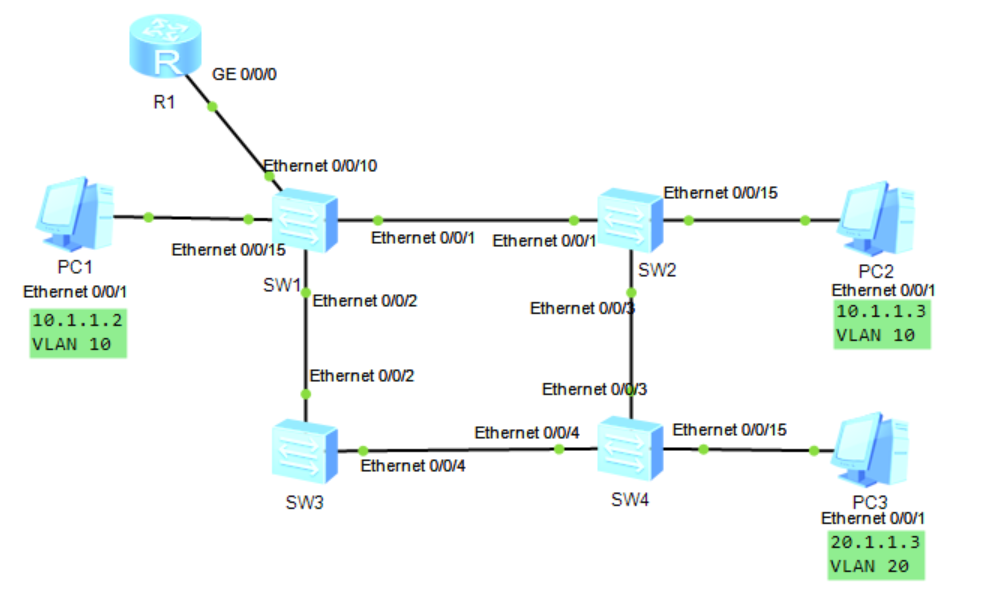

# 实验拓扑与地址规划

| 设备 | 接口 | VLAN | IP地址 | 备注 |
| :--- | :--- | :--- | :--- | :--- |
| PC1 | Eth0/0/1 | 10 | 10.1.1.2/24 | 网关: 10.1.1.254 |
| PC2 | Eth0/0/1 | 10 | 10.1.1.3/24 | 网关: 10.1.1.254 |
| PC3 | Eth0/0/1 | 20 | 20.1.1.3/24 | 网关: 20.1.1.254 |
| R1  | GE0/0/0.10 | 10 | 10.1.1.254/24 | 单臂路由子接口 |
| R1  | GE0/0/0.20 | 20 | 20.1.1.254/24 | 单臂路由子接口 |